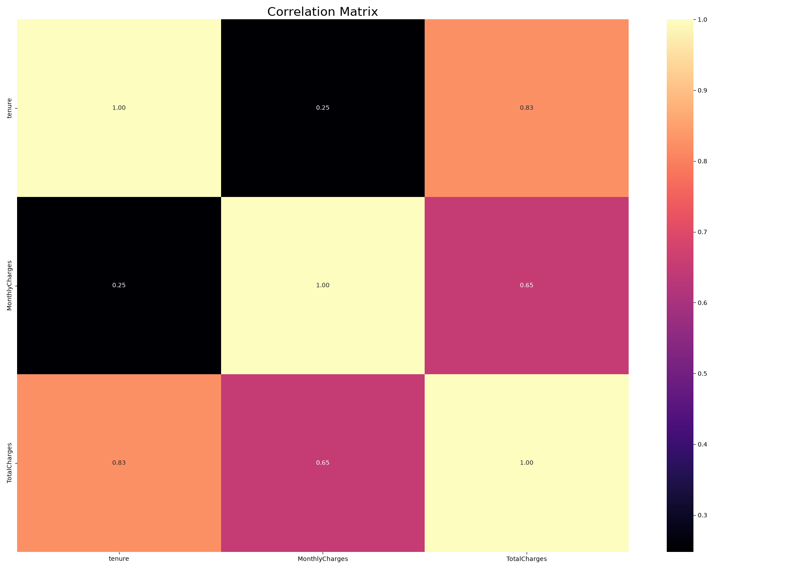
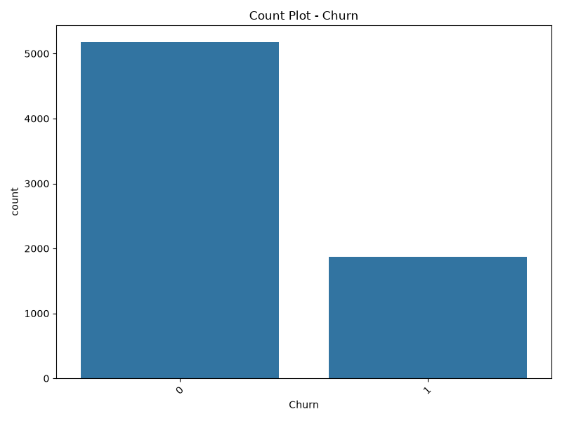
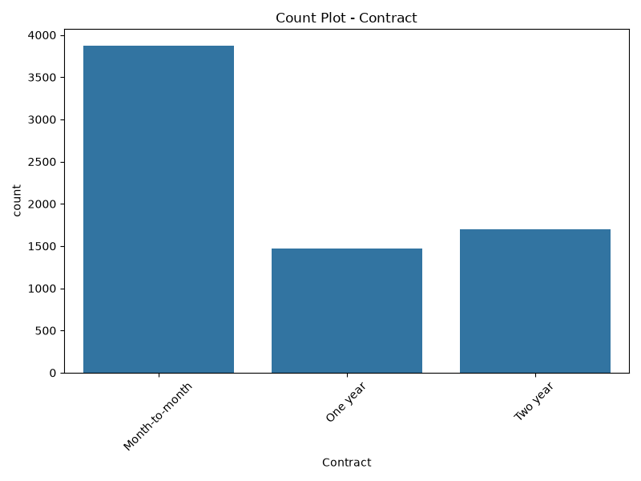
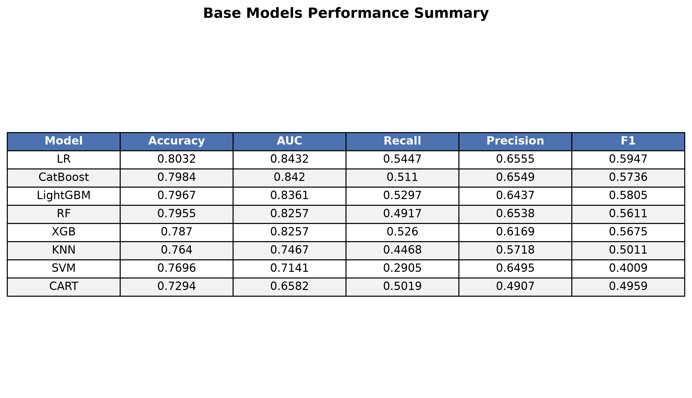
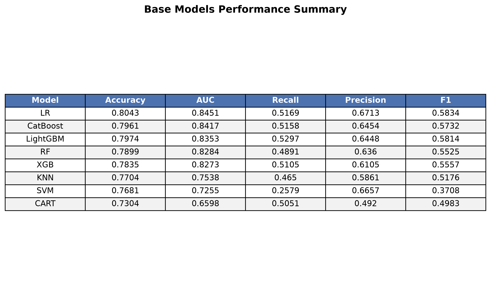
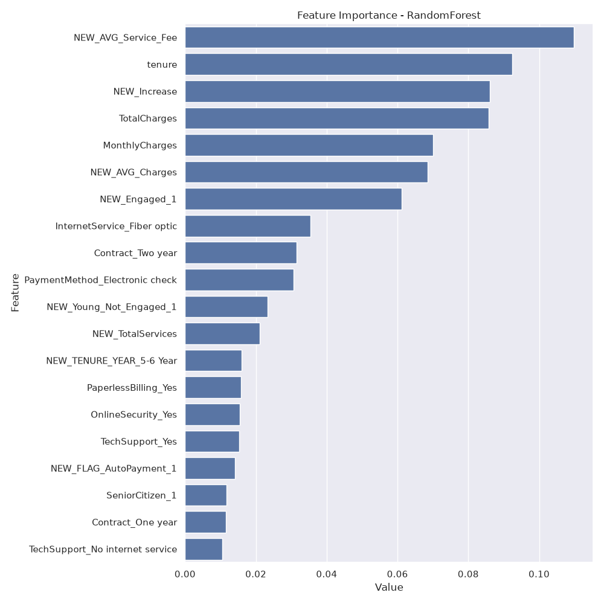
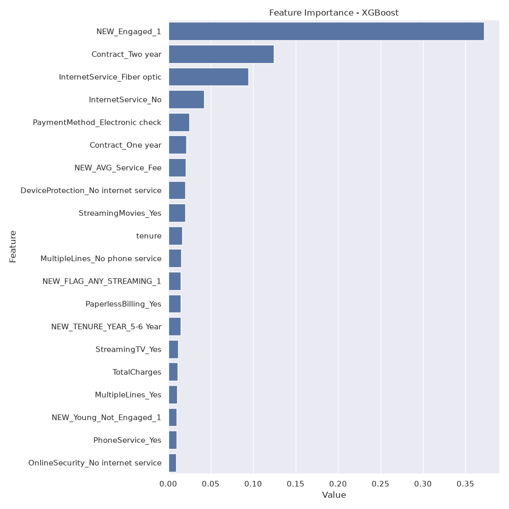
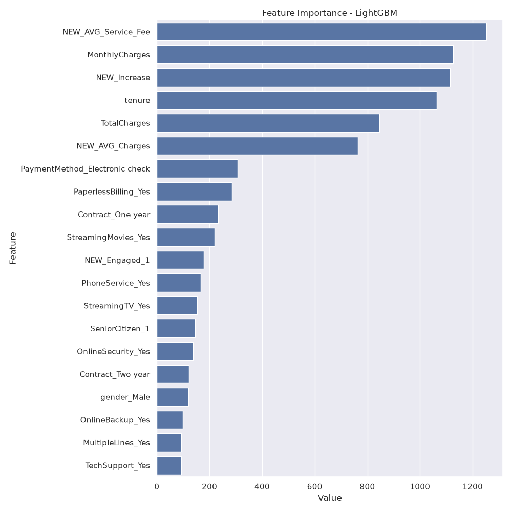
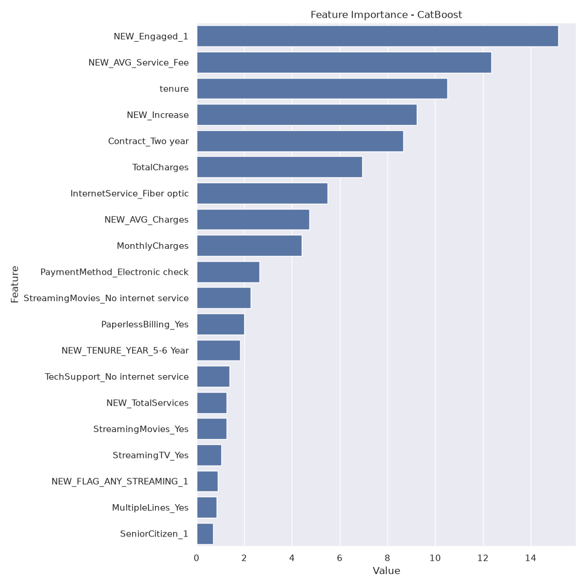

# 📉 Telco Customer Churn Prediction 

This project is an end-to-end Machine Learning web application designed to predict and analyze customer churn in the telecommunications industry. The pipeline covers exploratory data analysis (EDA), feature engineering, hyperparameter optimization, model evaluation, and an interactive web interface.

## 🌐 Live Demo
Test the application live in your browser: **[Live Streamlit App](https://telco-customer-churn-pediction-iu2jtdomamlzq8ooyrmrgu.streamlit.app/)**

---

## 🛠️ Running Locally

To run the project on your local machine, follow these steps:

** 1. Clone the repository:
   
   git clone [https://github.com/dudukbb/Telco-Customer-Churn-Pediction.git](https://github.com/dudukbb/Telco-Customer-Churn-Pediction.git)
   cd Telco-Customer-Churn-Pediction

---
** 2. Install the required dependencies:
  `
  pip install -r requirements.txt
  Launch the Streamlit application:

** 3. Launch the Streamlit application:

streamlit run app.py


End-to-end churn prediction pipeline featuring EDA, feature engineering, and hyperparameter tuning with top ML models."

---

## 🔗 Project Overview & My Workflow
I designed this project to cover the entire machine learning lifecycle step by step:

1. **Exploratory Data Analysis (EDA):** I inspected the data structure, analyzed categorical and numerical distributions, and visualized their relationships against the target variable (`Churn`).
2. **Missing & Outlier Value Analysis:** I handled missing values through proper imputation and suppressed outliers based on custom statistical thresholds.
3. **Feature Engineering:** I engineered domain-specific features to capture deep behavioral patterns and enhance model predictive power.
4. **Modeling & Hyperparameter Tuning:** I benchmarked baseline models and optimized top-tier algorithms (`RandomForest`, `XGBoost`, `LightGBM`, `CatBoost`) using `GridSearchCV` and k-fold cross-validation.
5. **Automated Output Management:** I implemented automated storage so that all performance metric tables (`.png`) and feature importance charts (`.png`) are saved directly into structured directories.

---

## 🔗 Feature Engineering
To capture customer loyalty and behavioral trends, I derived the following features:
* **`NEW_TENURE_YEAR`**: Grouped customer tenure into yearly bins (0-1 year up to 5-6 years).
* **`NEW_Engaged`**: Binary flag indicating if the customer holds a long-term contract (One or Two years).
* **`NEW_noProt`**: Indicator for customers lacking essential online security, backup, or tech support.
* **`NEW_TotalServices`**: Total count of active services subscribed by the customer.
* **`NEW_FLAG_ANY_STREAMING`**: Flag indicating usage of either TV or movie streaming services.
* **`NEW_FLAG_AutoPayment`**: Indicator for automated payment methods (Credit card or Bank transfer).
* **`NEW_AVG_Charges` & `NEW_Increase`**: Financial metrics tracking charge behaviors over tenure.
* **`NEW_AVG_Service_Fee`**: Average fee paid per subscribed service.

---

## 📊 Visual Outputs & Results

### 1. Exploratory Data Analysis & Target Interactions
Here are samples of how I analyzed the dataset, featuring general distributions, the correlation matrix, and the impacts of numerical and categorical variables on customer churn (`Churn`):

* **Correlation Matrix:**
  

* **Numerical & Categorical Distributions:**
  * 
  * 

* **Target Analysis (Impact of Numerical & Categorical Features on Churn):**
  * *Numerical Target Analysis (Boxplots):* Visualized how numerical metrics (such as tenure or charges) differ between churned and retained customers under `outputs/eda/target_analysis_numeric_plots/`.
  * *Categorical Target Analysis (Barplots):* Analyzed churn rates across different categories (such as internet service types, payment methods, and contracts) under `outputs/eda/target_analysis_categoric_plots/`.

---

### 2. Model Performance Summary Tables & Comparison
Below are the evaluation metrics tables comparing model performance across different stages of the pipeline:

* **Base Models Performance (Before Feature Engineering):**
  

* **Engineered Models Performance (After Feature Engineering & Encoding):**
  *(Note: This table reflects model performances after applying my custom feature engineering steps, missing value imputation, and One-Hot Encoding across all baseline algorithms).*
  


#### 🏆 My Model Selection & Results Summary:
* **Before Feature Engineering (Base Models):** 
  * *Top Performing Models:* **LR**, **CatBoost**, and **LightGBM** achieved the highest baseline scores[cite: 1]. **LR** reached an **Accuracy** of **0.8032** and an **AUC** of **0.8432**, while **CatBoost** and **LightGBM** closely followed with **Accuracy** scores of **0.7984** and **0.7967**, and **AUC** scores of **0.8420** and **0.8361** respectively[cite: 1].
* **After Feature Engineering & Hyperparameter Tuning:**
  * By incorporating my newly engineered domain features (`NEW_TENURE_YEAR`, `NEW_Engaged`, `NEW_TotalServices`, etc.) and optimizing parameters via `GridSearchCV`, **LR** maintained the highest **Accuracy** at **0.8043** with an **AUC** of **0.8451**, whereas tree-based models like **CatBoost** (**Accuracy: 0.7961**, **AUC: 0.8417**) and **LightGBM** (**Accuracy: 0.7974**, **AUC: 0.8353**) yielded robust generalization performance with balanced F1-Scores[cite: 2].
* **Final Model Selection:**
  * Although **Logistic Regression (LR)** achieved the highest raw accuracy, I selected **CatBoost** and **LightGBM** as my primary production models. Tree-based gradient boosting models handle complex non-linear feature interactions, outlier robustness, and feature importance tracking far better, making them the superior choice for real-world customer churn prediction and business decision-making.

---

### 3. Feature Importance Visualizations
Here is how my optimized models ranked the most important features driving customer churn:

* **Random Forest Feature Importance:**
  

* **XGBoost Feature Importance:**
  

* **LightGBM Feature Importance:**
  

* **CatBoost Feature Importance:**
  

---

## 🔗 Tech Stack & Libraries
* **Python** 
* **Data Analysis:** `Pandas`, `NumPy`
* **Visualization:** `Matplotlib`, `Seaborn`
* **Machine Learning & Modeling:** 
  * `Scikit-Learn` (`GridSearchCV`, `cross_validate`, `LabelEncoder`, `LogisticRegression`, `KNeighborsClassifier`, `DecisionTreeClassifier`, `RandomForestClassifier`, `SVC`)
  * `XGBoost`
  * `LightGBM`
  * `CatBoost`

---

## 📂 Project Directory Structure
```text
Telco_Customer_Churn_Prediction/
│
├── outputs/
│   ├── eda/                                   # EDA distribution and target analysis plots
│   │   ├── categorical_plots/
│   │   ├── numerical_plots/
│   │   ├── target_analysis_categoric/
│   │   ├── target_analysis_categoric_plots/
│   │   ├── target_analysis_numeric/
│   │   └── target_analysis_numeric_plots/
│   ├── importances/                           # Feature importance visual charts
│   │   ├── RandomForest_importance.png
│   │   ├── XGBoost_importance.png
│   │   ├── LightGBM_importance.png
│   │   └── CatBoost_importance.png
│   └── metrics/                               # Performance summary tables
│       ├── base_models_summary.png
│       └── engineered_models_summary.png
│
├── Telco-Customer-Churn-FromDB.csv            # Dataset
├── Telco_Churn.py                             # Main pipeline Python script
├── export_from_db.py                          # Database export script (fetches data directly from DB)
└── README.md                                  # Project documentation
